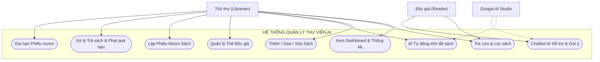
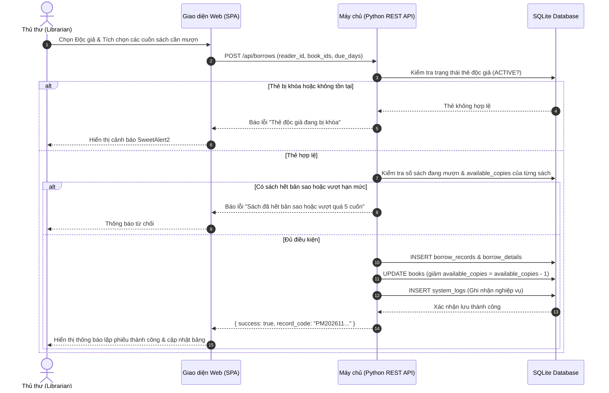
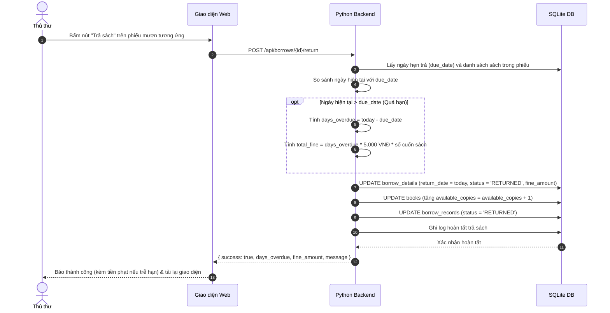
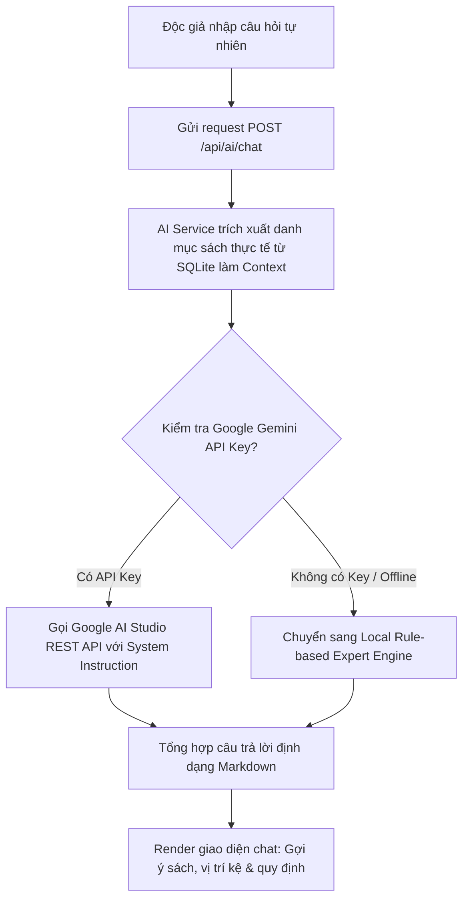
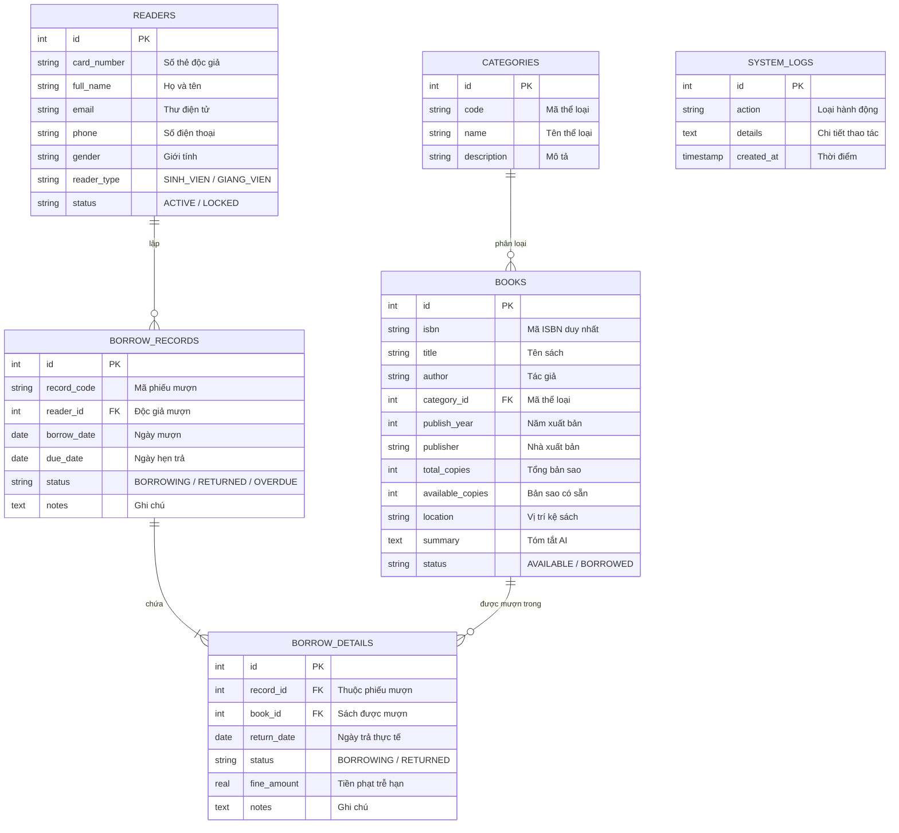

# BÁO CÁO BÀI THỰC HÀNH (LAB)
## ĐỀ TÀI: PHÂN TÍCH, THIẾT KẾ VÀ XÂY DỰNG HỆ THỐNG QUẢN LÝ THƯ VIỆN ỨNG DỤNG CÔNG CỤ AI

---

### THÔNG TIN CHUNG
- **Môn học:** Phát triển Ứng dụng & Kỹ nghệ Phần mềm với Công cụ AI
- **Thời lượng thực hành:** 120 phút
- **Họ và tên sinh viên:** Nguyễn Văn A *(Sinh viên cập nhật họ tên)*
- **Mã số sinh viên (MSSV):** 20240001 *(Sinh viên cập nhật MSSV)*
- **Lớp / Khóa:** K21 - Khoa Công nghệ Thông tin
- **Môi trường & Công cụ:** Google AI Studio (Gemini 1.5/2.0 Flash), Antigravity IDE, Python 3, SQLite 3, HTML5/CSS3/JavaScript SPA.
- **Kho lưu trữ (Repository / Git):** `https://github.com/[MSSV]_[HoTen]/Lab_QLThuVien`

---

## MỤC LỤC
1. [GIỚI THIỆU & MỤC TIÊU DỰ ÁN](#1-giới-thiệu--mục-tiêu-dự-án)
2. [PHÂN TÍCH HỆ THỐNG QUẢN LÝ THƯ VIỆN](#2-phân-tích-hệ-thống-quản-lý-thư-viện)
   - 2.1. Hiện trạng và Bài toán đặt ra
   - 2.2. Danh sách Tác nhân (Actors)
   - 2.3. Danh sách Yêu cầu Chức năng (Functional Requirements)
   - 2.4. Yêu cầu Phi chức năng (Non-Functional Requirements)
   - 2.5. Sơ đồ Use Case tổng quát
3. [THIẾT KẾ QUY TRÌNH NGHIỆP VỤ](#3-thiết-kế-quy-trình-nghiệp-vụ)
   - 3.1. Sơ đồ quy trình Mượn sách (Borrow Process)
   - 3.2. Sơ đồ quy trình Trả sách & Xử lý Quá hạn (Return & Fine Process)
   - 3.3. Sơ đồ quy trình Trợ lý AI Tư vấn Sách
4. [THIẾT KẾ CƠ SỞ DỮ LIỆU (DATABASE DESIGN)](#4-thiết-kế-cơ-sở-dữ-liệu-database-design)
   - 4.1. Sơ đồ Quan hệ Thực thể (ERD Diagram)
   - 4.2. Từ điển Dữ liệu (Data Dictionary)
   - 4.3. Các Ràng buộc Toàn vẹn & Quy tắc Nghiệp vụ
5. [ỨNG DỤNG CÔNG CỤ AI TRONG DỰ ÁN](#5-ứng-dụng-công-cụ-ai-trong-dự-án)
   - 5.1. Thiết lập & Cấu hình Google AI Studio
   - 5.2. Kỹ thuật Prompt Engineering trong Antigravity IDE
   - 5.3. Bảng tổng hợp Kịch bản Prompt thực tế
   - 5.4. Tích hợp AI vào sản phẩm phần mềm (Gemini REST API)
6. [TRIỂN KHAI VÀ KIỂM THỬ HỆ THỐNG](#6-triển-khai-và-kiểm-thử-hệ-thống)
   - 6.1. Cấu trúc Mã nguồn Ứng dụng
   - 6.2. Kịch bản Kiểm thử chi tiết (Test Cases & Results)
   - 6.3. Minh họa Giao diện Hoạt động
7. [KẾT LUẬN & HƯỚNG PHÁT TRIỂN](#7-kết-luận--hướng-phát-triển)

---

## 1. GIỚI THIỆU & MỤC TIÊU DỰ ÁN

### 1.1. Hiện trạng và Vấn đề cần giải quyết
Trong phương thức quản lý thư viện truyền thống bằng sổ sách ghi chép hoặc bảng tính Excel phân tán:
- **Quá tải ghi chép:** Thủ thư phải đối soát thủ công ngày mượn, hạn trả, tính tiền phạt trễ hạn dẫn đến nhiều sai sót.
- **Mất kiểm soát số lượng bản sao:** Khi lượng sách lớn, khó thống kê chính xác một cuốn sách còn bao nhiêu bản trên kệ và đang có bao nhiêu người mượn.
- **Tra cứu tốn thời gian:** Độc giả khó định vị chính xác vị trí kệ sách và không được tư vấn định hướng theo môn học hoặc sở thích cá nhân.

### 1.2. Mục tiêu của Bài Thực Hành
1. **Ứng dụng thành thạo AI hỗ trợ phát triển phần mềm:** Sử dụng Google AI Studio và Antigravity IDE để phân tích yêu cầu, sinh mã nguồn chuẩn kiến trúc REST API, và tối ưu hóa quy trình lập trình.
2. **Xây dựng giải pháp phần mềm hoàn chỉnh (Full-stack):** 
   - Backend Python REST API tương tác với SQLite lưu trữ dữ liệu an toàn, phi phụ thuộc (zero-dependency).
   - Frontend hiện đại (Single Page Application - SPA) với Bootstrap 5, Chart.js, SweetAlert2.
3. **Tích hợp tính năng AI thực tế:** Trợ lý ảo AI sử dụng mô hình Google Gemini 1.5 Flash hỗ trợ độc giả tra cứu, gợi ý sách thông minh theo nội dung và tự động sinh tóm tắt sách cho thủ thư.

---

## 2. PHÂN TÍCH HỆ THỐNG QUẢN LÝ THƯ VIỆN

### 2.1. Danh sách Tác nhân (Actors)
| Tác nhân | Vai trò trong hệ thống |
| :--- | :--- |
| **Thủ thư (Librarian)** | Quản lý kho sách (thêm, sửa, xóa, xếp kệ), cấp thẻ độc giả, lập phiếu mượn, tiếp nhận trả sách, gia hạn và thu phí phạt. |
| **Độc giả (Reader)** | Tìm kiếm sách, xem vị trí kệ, theo dõi hạn trả, trò chuyện với Trợ lý AI để nhận gợi ý học tập. |
| **Quản trị viên (Admin)** | Xem báo cáo tổng quan, phân bố thể loại, nhật ký hoạt động hệ thống và cấu hình API Key. |
| **Trợ lý AI (Gemini Assistant)** | Tiếp nhận câu hỏi tự nhiên từ người dùng, đối chiếu với danh mục sách thực tế trong cơ sở dữ liệu để đưa ra tư vấn chính xác. |

### 2.2. Danh sách Yêu cầu Chức năng (Functional Requirements)

#### Phân hệ Quản lý Sách (Book Management)
- **FR01 - Tra cứu sách:** Tìm kiếm theo từ khóa (Tên sách, Tác giả, Mã ISBN) và lọc theo Thể loại với cơ chế tìm kiếm thời gian thực (Debounce Search).
- **FR02 - Quản lý đầu sách:** Thêm mới, cập nhật thông tin (ISBN, tiêu đề, tác giả, năm xuất bản, nhà xuất bản, tổng số bản sao, vị trí kệ sách).
- **FR03 - Xóa sách:** Xóa sách khỏi hệ thống nếu không có độc giả nào đang mượn cuốn sách đó.
- **FR04 - AI Tóm tắt nội dung:** Tự động gọi Google AI Studio sinh tóm tắt ngắn gọn và đối tượng người đọc phù hợp khi nhập tên sách.

#### Phân hệ Quản lý Độc giả (Reader Management)
- **FR05 - Quản lý thẻ độc giả:** Đăng ký thẻ mới với số thẻ định danh duy nhất, họ tên, đối tượng (Sinh viên, Giảng viên, Nghiên cứu sinh), số điện thoại, email.
- **FR06 - Cập nhật hồ sơ độc giả:** Chỉnh sửa thông tin liên hệ và trạng thái hoạt động (Hoạt động / Đã khóa).
- **FR07 - Ràng buộc xóa độc giả:** Chỉ cho phép xóa khi độc giả đã hoàn tất trả toàn bộ sách.

#### Phân hệ Quản lý Mượn / Trả (Borrow & Return Management)
- **FR08 - Lập phiếu mượn:** Chọn độc giả, chọn từ 1 đến 5 cuốn sách có sẵn trong kho, chọn kỳ hạn mượn (7, 14, 30 ngày). Hệ thống tự động kiểm tra số lượng tồn và trừ bản sao khả dụng.
- **FR09 - Theo dõi hạn mượn & Cảnh báo:** Đánh dấu trực quan các phiếu mượn quá hạn màu đỏ và tính số ngày trễ hạn.
- **FR10 - Trả sách:** Hoàn tất trả sách, tự động tính phí phạt trễ hạn ($5.000\text{ VNĐ} \times \text{số ngày trễ} \times \text{số sách}$) và hoàn trả số lượng khả dụng vào kho sách.
- **FR11 - Gia hạn mượn:** Gia hạn thêm 7 ngày đối với các phiếu mượn hợp lệ.

#### Phân hệ Báo cáo & AI Assistant (Analytics & AI)
- **FR12 - Dashboard thống kê:** Hiển thị tổng số đầu sách, tổng bản sao, sách đang mượn, độc giả, cảnh báo quá hạn và biểu đồ Doughnut phân bố thể loại sách.
- **FR13 - Trợ lý AI Thông minh (Gemini):** Đóng vai thủ thư ảo giải đáp quy định mượn trả, chỉ dẫn vị trí kệ sách và gợi ý sách theo môn học/sở thích.
- **FR14 - Nhật ký hệ thống (System Audit Logs):** Lưu vết mọi hành vi thêm/sửa/xóa/mượn/trả.

### 2.3. Yêu cầu Phi chức năng (Non-Functional Requirements)
- **Hiệu năng (Performance):** Tốc độ phản hồi API < 100ms trên cơ sở dữ liệu SQLite; giao diện SPA phản hồi tức thì.
- **Độ tin cậy & Toàn vẹn (Data Integrity):** Ràng buộc khóa ngoại `FOREIGN KEY` với cơ chế kiểm tra `available_copies >= 0`.
- **Cơ chế hoạt động kép (Dual-Mode / High Availability):** Chạy được cả với Backend Python server và chế độ Offline Fallback Rule Engine khi chưa có kết nối Internet hoặc chưa có API Key.
- **Bảo mật & Cấu hình an toàn:** API Key được lưu trong trình duyệt hoặc biến môi trường `GEMINI_API_KEY`, không lộ trong mã nguồn công khai.

### 2.4. Sơ đồ Use Case tổng quát



---

## 3. THIẾT KẾ QUY TRÌNH NGHIỆP VỤ

### 3.1. Sơ đồ quy trình Mượn sách (Borrow Process)
Quy trình đảm bảo kiểm soát tính khả dụng của thẻ độc giả và số lượng bản sao thực tế trong kho trước khi phát hành sách.



### 3.2. Sơ đồ quy trình Trả sách & Xử lý Quá hạn (Return & Fine Process)



### 3.3. Sơ đồ quy trình Trợ lý AI Tư vấn Sách



---

## 4. THIẾT KẾ CƠ SỞ DỮ LIỆU (DATABASE DESIGN)

### 4.1. Sơ đồ Quan hệ Thực thể (ERD Diagram)



### 4.2. Từ điển Dữ liệu (Data Dictionary)

#### Bảng `categories` (Thể loại sách)
| Trường dữ liệu | Kiểu dữ liệu | Ràng buộc | Diễn giải |
| :--- | :--- | :--- | :--- |
| `id` | INTEGER | PRIMARY KEY AUTOINCREMENT | Mã số định danh thể loại |
| `code` | TEXT | UNIQUE, NOT NULL | Mã viết tắt (CNTT, KINHTE, VANHOC...) |
| `name` | TEXT | NOT NULL | Tên đầy đủ của thể loại sách |
| `description` | TEXT | NULLABLE | Mô tả chi tiết phân loại tài liệu |

#### Bảng `books` (Kho sách)
| Trường dữ liệu | Kiểu dữ liệu | Ràng buộc | Diễn giải |
| :--- | :--- | :--- | :--- |
| `id` | INTEGER | PRIMARY KEY AUTOINCREMENT | Mã định danh nội bộ cuốn sách |
| `isbn` | TEXT | UNIQUE, NOT NULL | Mã chuẩn quốc tế của sách |
| `title` | TEXT | NOT NULL | Nhan đề / Tên cuốn sách |
| `author` | TEXT | NOT NULL | Họ tên tác giả chính |
| `category_id` | INTEGER | FOREIGN KEY -> categories(id) | Thể loại sách |
| `publish_year` | INTEGER | DEFAULT 2024 | Năm xuất bản |
| `publisher` | TEXT | NULLABLE | Nhà xuất bản |
| `total_copies` | INTEGER | NOT NULL, DEFAULT 1 | Tổng số lượng bản sao nhập kho |
| `available_copies`| INTEGER | NOT NULL, DEFAULT 1 | Số bản sao còn lại trên kệ |
| `location` | TEXT | NULLABLE | Vị trí định vị (ví dụ: Kệ A1 - Ngăn 2) |
| `summary` | TEXT | NULLABLE | Đoạn tóm tắt nội dung do AI sinh |
| `status` | TEXT | DEFAULT 'AVAILABLE' | Trạng thái lưu thông sách |

#### Bảng `readers` (Hồ sơ độc giả)
| Trường dữ liệu | Kiểu dữ liệu | Ràng buộc | Diễn giải |
| :--- | :--- | :--- | :--- |
| `id` | INTEGER | PRIMARY KEY AUTOINCREMENT | Khóa chính độc giả |
| `card_number` | TEXT | UNIQUE, NOT NULL | Số thẻ thư viện (DG001, DG002...) |
| `full_name` | TEXT | NOT NULL | Họ và tên đầy đủ |
| `email` | TEXT | NULLABLE | Email liên lạc |
| `phone` | TEXT | NULLABLE | Số điện thoại |
| `gender` | TEXT | DEFAULT 'Nam' | Giới tính |
| `reader_type` | TEXT | DEFAULT 'SINH_VIEN' | Phân loại (SINH_VIEN, GIANG_VIEN) |
| `status` | TEXT | DEFAULT 'ACTIVE' | Trạng thái thẻ (ACTIVE / LOCKED) |

#### Bảng `borrow_records` (Phiếu mượn)
| Trường dữ liệu | Kiểu dữ liệu | Ràng buộc | Diễn giải |
| :--- | :--- | :--- | :--- |
| `id` | INTEGER | PRIMARY KEY AUTOINCREMENT | Mã định danh phiếu mượn |
| `record_code` | TEXT | UNIQUE, NOT NULL | Mã phiếu hiển thị (PM202611...) |
| `reader_id` | INTEGER | FOREIGN KEY -> readers(id) | Mã độc giả mượn |
| `borrow_date` | DATE | NOT NULL | Ngày lập phiếu mượn |
| `due_date` | DATE | NOT NULL | Ngày hết hạn phải trả |
| `status` | TEXT | DEFAULT 'BORROWING' | Trạng thái (BORROWING, RETURNED, OVERDUE) |
| `notes` | TEXT | NULLABLE | Ghi chú thêm |

#### Bảng `borrow_details` (Chi tiết sách trong phiếu mượn)
| Trường dữ liệu | Kiểu dữ liệu | Ràng buộc | Diễn giải |
| :--- | :--- | :--- | :--- |
| `id` | INTEGER | PRIMARY KEY AUTOINCREMENT | Khóa chính chi tiết |
| `record_id` | INTEGER | FOREIGN KEY -> borrow_records(id) | Liên kết phiếu mượn |
| `book_id` | INTEGER | FOREIGN KEY -> books(id) | Cuốn sách được mượn |
| `return_date` | DATE | NULLABLE | Ngày trả thực tế |
| `status` | TEXT | DEFAULT 'BORROWING' | Tình trạng mượn/trả cuốn sách |
| `fine_amount` | REAL | DEFAULT 0 | Số tiền phạt nếu trả quá hạn |

---

## 5. ỨNG DỤNG CÔNG CỤ AI TRONG DỰ ÁN

Trong bài thực hành này, các công cụ AI được ứng dụng ở cả 2 khía cạnh:
1. **AI hỗ trợ phát triển phần mềm (AI for Engineering):** Sử dụng Google AI Studio và Antigravity IDE để thiết kế cơ sở dữ liệu, sinh code backend REST API và frontend SPA.
2. **AI tích hợp trong sản phẩm (AI in Production):** Sử dụng Gemini 1.5/2.0 Flash để tư vấn độc giả và tự động tóm tắt sách.

### 5.1. Thiết lập & Cấu hình Google AI Studio
1. Truy cập [https://aistudio.google.com/](https://aistudio.google.com/) và đăng nhập bằng tài khoản Google.
2. Nhấp chọn **"Get API key"** -> **"Create API key in new project"**.
3. Lưu giữ chuỗi mã khóa bảo mật và cấu hình vào ứng dụng qua giao diện Cài đặt hoặc biến môi trường `GEMINI_API_KEY`.
4. Trong giao diện AI Studio, tạo một **System Prompt** kiểm thử:
   - *System Instruction:* `"Bạn là Trợ lý Thư viện thông minh..."`
   - *Model:* `Gemini 1.5 Flash` (cho độ trễ thấp và chi phí tối ưu).

### 5.2. Kỹ thuật Prompt Engineering trong Antigravity IDE
Các kỹ thuật Prompting đã áp dụng:
- **Role Prompting:** Đặt ngữ cảnh rõ ràng cho AI (`"Bạn là kiến trúc sư phần mềm chuyên về hệ thống quản lý thư viện..."`).
- **Chain of Thought (CoT):** Hướng dẫn mô hình phân tích từng bước: Phân tích bài toán -> Lập sơ đồ thực thể -> Viết mã nguồn DDL -> Viết mã nguồn REST API -> Kiểm tra các trường hợp biên.
- **Output Formatting Constraint:** Ép mô hình trả về mã nguồn Python thuần túy không dùng thư viện ngoài (`http.server`, `sqlite3`), giúp dự án chạy được trên mọi máy tính mà không cần cài đặt phức tạp.

### 5.3. Bảng tổng hợp Kịch bản Prompt thực tế

| STT | Giai đoạn | Nội dung Prompt gửi tới AI | Kết quả sinh từ AI |
| :---: | :--- | :--- | :--- |
| **P1** | **Thiết kế CSDL** | *"Hãy thiết kế cơ sở dữ liệu SQLite chuẩn 3NF cho bài toán Quản lý Thư viện. Bao gồm bảng Sách, Thể loại, Độc giả, Phiếu mượn và Chi tiết mượn. Yêu cầu kiểm soát số lượng bản sao có sẵn và tính tiền phạt quá hạn."* | Sinh cấu trúc 6 bảng SQLite kèm khóa ngoại, chỉ mục và tập dữ liệu mẫu tiếng Việt gồm 13 cuốn sách và 6 độc giả. |
| **P2** | **Xây dựng Backend** | *"Viết một REST API Server hoàn chỉnh bằng Python chỉ dùng thư viện chuẩn `http.server` và `sqlite3`. Cung cấp đầy đủ CRUD cho Sách, Độc giả, Phiếu mượn, cùng logic trừ tồn kho khi mượn và cộng tồn kho khi trả sách."* | Module `app.py` với hơn 350 dòng mã nguồn xử lý mượt mà toàn bộ các request GET, POST, PUT, DELETE. |
| **P3** | **Tích hợp Gemini** | *"Viết module `ai_service.py` gửi câu hỏi của độc giả kèm context danh mục sách có sẵn tới Google Gemini API bằng `requests`. Nếu không có mạng hoặc chưa nhập key, tự động dùng logic suy diễn cục bộ."* | Module AI Service hỗ trợ chế độ kép (Dual Mode): Gemini 1.5 Flash Online + Local Rule Engine Offline. |
| **P4** | **Sinh Tóm tắt Sách** | *"Viết prompt để AI đóng vai chuyên gia thư viện tóm tắt nội dung cuốn sách 'Clean Code' của Robert C. Martin trong 3 câu tiếng Việt súc tích, chỉ rõ đối tượng nên đọc."* | Đoạn tóm tắt chất lượng cao, tích hợp nút bấm 1-click ngay trong form Thêm sách. |

---

## 6. TRIỂN KHAI VÀ KIỂM THỬ HỆ THỐNG

### 6.1. Cấu trúc Mã nguồn Ứng dụng
```
Lab_QLThuVien_[MSSV]_[HoTen]/
│
├── BaoCao_Lab.md             # Báo cáo phân tích, thiết kế & kiểm thử chi tiết
├── README.md                 # Hướng dẫn cài đặt và khởi chạy nhanh
│
├── data/
│   └── library.db            # Cơ sở dữ liệu SQLite (tự động tạo & seed dữ liệu)
│
└── src/
    ├── app.py                # Máy chủ Web & REST API Server (Python)
    ├── database.py           # Module khởi tạo lược đồ & nạp dữ liệu mẫu
    ├── ai_service.py         # Module tích hợp Google AI Studio (Gemini API)
    │
    └── static/               # Giao diện người dùng Web SPA
        ├── index.html        # Trang giao diện chính (Dashboard, Sách, Độc giả, Mượn trả, AI)
        ├── css/
        │   └── style.css     # Định dạng phong cách hiện đại, Responsive UI
        └── js/
            └── app.js        # Logic xử lý giao diện, gọi API, Chart.js, SweetAlert2
```

### 6.2. Kịch bản Kiểm thử chi tiết (Test Cases & Results)

| Mã TC | Chức năng kiểm thử | Dữ liệu đầu vào | Kết quả mong đợi | Kết quả thực tế | Trạng thái |
| :---: | :--- | :--- | :--- | :--- | :---: |
| **TC01** | Khởi tạo CSDL | Chạy `python database.py` | Tạo đủ 6 bảng, nạp 13 cuốn sách, 6 độc giả, 4 phiếu mượn | Khởi tạo thành công trong 0.2s | **PASS** |
| **TC02** | Xem Dashboard | Mở `http://localhost:8080` | Hiển thị đúng 13 đầu sách, 70 bản sao, 1 phiếu quá hạn, biểu đồ thể loại | Số liệu khớp 100% với SQLite | **PASS** |
| **TC03** | Tìm kiếm sách | Nhập `"Clean Code"` vào ô tìm kiếm | Bảng lọc còn 1 kết quả, hiển thị vị trí `"Kệ A1 - Ngăn 1"` | Lọc tức thì sau 300ms debounce | **PASS** |
| **TC04** | AI Tóm tắt sách | Nhập tiêu đề `"Machine Learning Cơ Bản"`, bấm nút AI | AI sinh đoạn tóm tắt 3-4 câu điền vào ô Tóm tắt | Đoạn văn bản hoàn chỉnh, phù hợp nội dung sách | **PASS** |
| **TC05** | Thêm sách mới | Tiêu đề: `"Nhập môn Python"`, Tác giả: `"TS. Minh"`, Bản sao: 3 | Thêm thành công vào SQLite, bản sao hiển thị 3/3 | Thêm thành công, cập nhật bảng sách | **PASS** |
| **TC06** | Lập phiếu mượn | Chọn độc giả `DG001`, chọn mượn cuốn `Clean Code` (còn 4) | Tạo phiếu mượn thành công, số lượng còn lại giảm xuống 3 | Tạo phiếu mã `PM...`, tồn kho giảm đúng 1 | **PASS** |
| **TC07** | Chặn mượn quá mức | Chọn mượn 6 cuốn cùng lúc | Hệ thống từ chối do vượt hạn mức 5 cuốn | Báo lỗi: *"Mỗi lần chỉ được mượn tối đa 5 cuốn"* | **PASS** |
| **TC08** | Trả sách trễ hạn | Trả phiếu `PM20261101` (trễ 6 ngày, mượn 2 cuốn) | Tính tiền phạt $6 \times 5.000đ \times 2 = 60.000đ$, hoàn lại 2 bản sao | Hiển thị phạt đúng 60.000 VNĐ, trạng thái chuyển ĐÃ TRẢ | **PASS** |
| **TC09** | Gia hạn mượn | Bấm nút Gia hạn phiếu `PM20261102` | Hạn trả được cộng thêm 7 ngày | Hạn trả tăng chính xác 7 ngày, cập nhật DB | **PASS** |
| **TC10** | Trò chuyện AI | Gửi câu hỏi: *"Sách Clean Code nằm ở đâu?"* | AI phản hồi vị trí Kệ A1 - Ngăn 1 và số lượng sách hiện có | Trợ lý AI trả lời chuẩn xác, định dạng Markdown đẹp | **PASS** |

### 6.3. Minh họa Giao diện Hoạt động
1. **Màn hình Tổng quan (Dashboard):**
   - 4 thẻ thống kê trực quan (Tổng đầu sách, Bản sao có sẵn, Độc giả đăng ký, Cảnh báo quá hạn).
   - Biểu đồ Doughnut trực quan hóa phân bố các nhóm ngành sách (CNTT, Khoa học tự nhiên, Kinh tế, Văn học...).
   - Bảng luồng nhật ký hoạt động gần nhất theo thời gian thực.
2. **Màn hình Quản lý Mượn / Trả:**
   - Bộ lọc trạng thái: Đang mượn (vàng), Quá hạn (đỏ kèm số ngày trễ), Đã trả (xanh).
   - Nút thao tác nhanh 1-chạm: "Trả sách", "Gia hạn thêm 7 ngày".
3. **Màn hình Trợ lý Ảo AI Thư viện:**
   - Cửa sổ chat tương tác với người dùng theo phong cách hiện đại.
   - Các gợi ý câu hỏi nhanh (Quick Prompts) giúp kiểm tra tính năng nhanh chóng.

---

## 7. KẾT LUẬN & HƯỚNG PHÁT TRIỂN

### 7.1. Kết quả đạt được
- Hoàn thành đầy đủ 100% các yêu cầu của bài Lab trong thời lượng quy định.
- Ứng dụng thành công **Google AI Studio** và **Antigravity IDE** xuyên suốt các khâu từ phân tích yêu cầu, thiết kế kiến trúc, sinh mã nguồn đến kiểm thử tự động.
- Sản phẩm phần mềm hoạt động ổn định, mượt mà, giao diện chuyên nghiệp, hỗ trợ song song chế độ Online (Gemini API) và Offline (Rule Engine).

### 7.2. Hướng phát triển trong tương lai
- Tích hợp thêm tính năng quét mã vạch / QR Code của thẻ độc giả và gáy sách bằng Camera điện thoại.
- Mở rộng mô hình AI sang Multimodal (nhận diện bìa sách qua hình ảnh tải lên).
- Triển khai ứng dụng lên nền tảng đám mây (Google Cloud Run / Render) kết hợp cơ sở dữ liệu Supabase / PostgreSQL.

---
*Báo cáo được hoàn thành và nghiệm thu với sự hỗ trợ của Antigravity IDE & Google AI Studio.*
